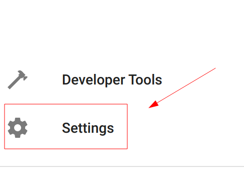
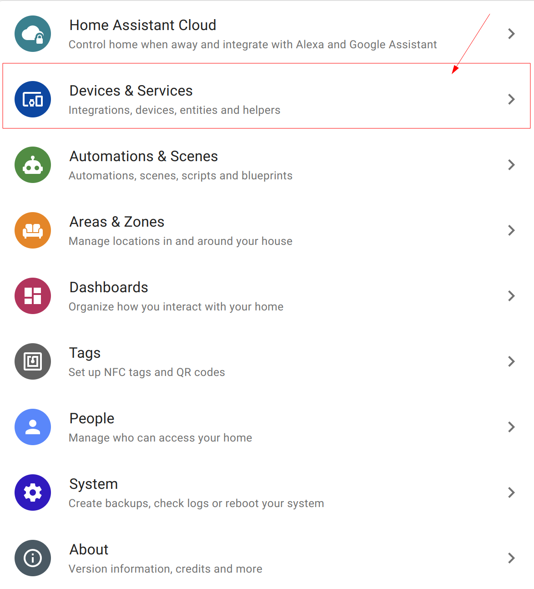
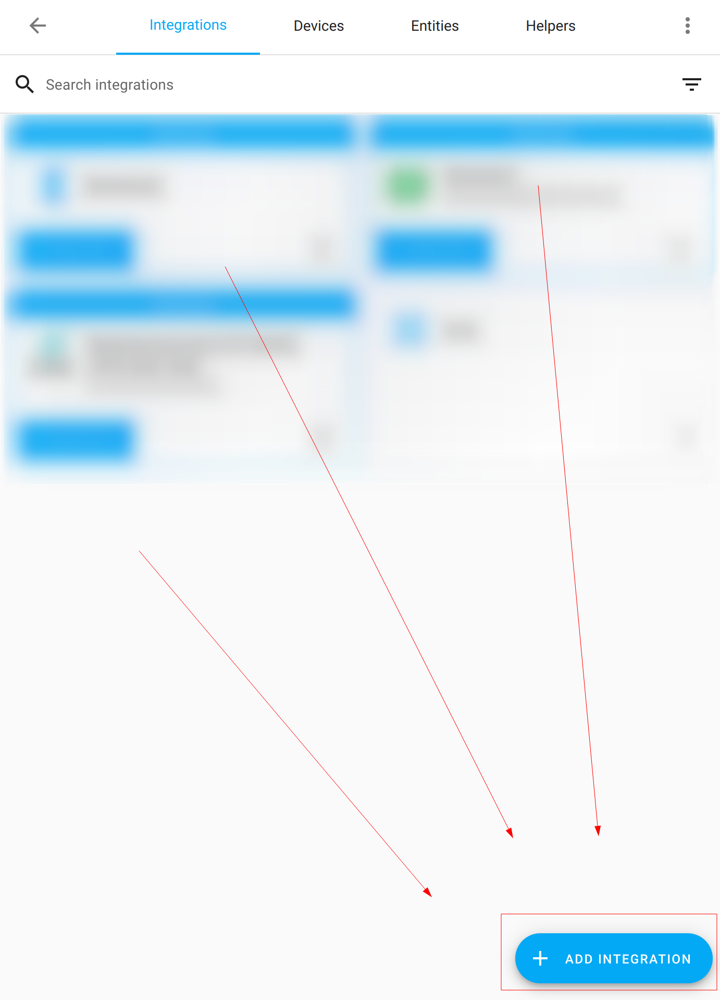
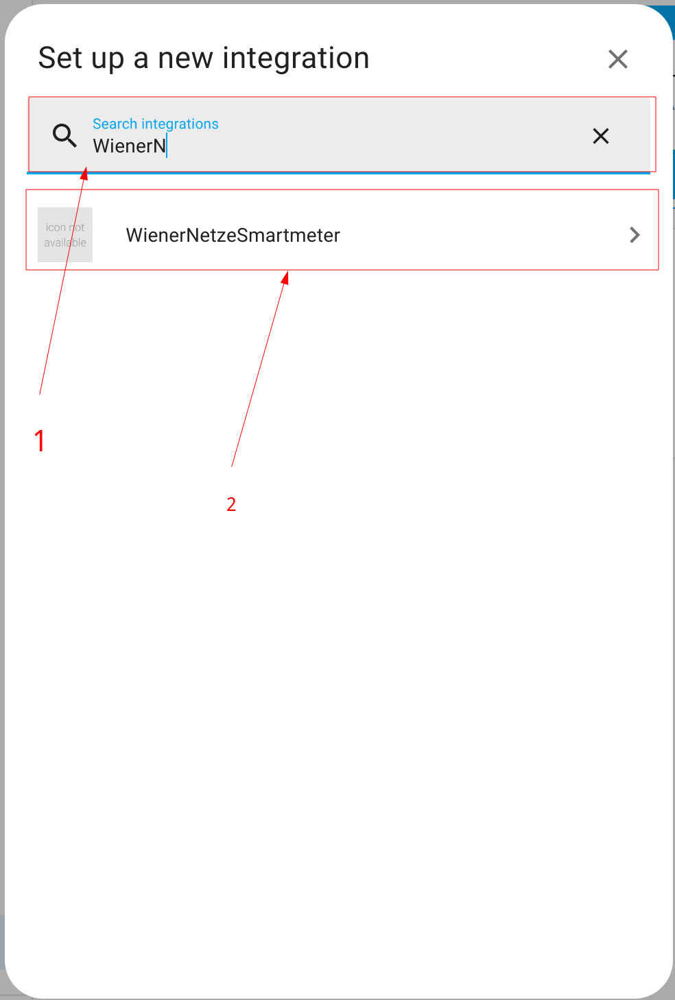
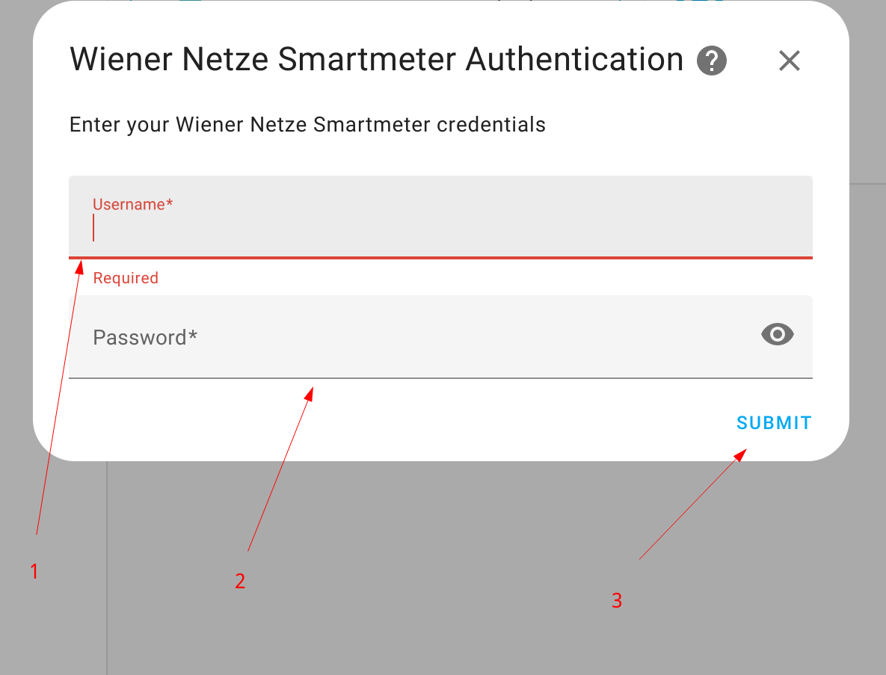
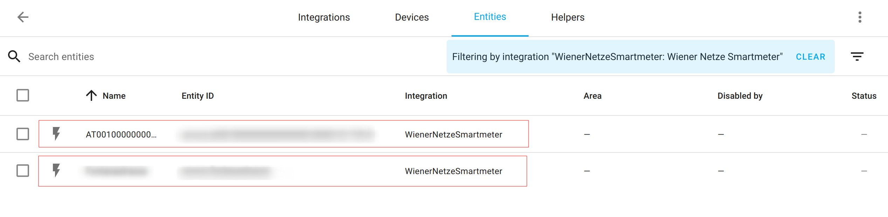

# Wiener Netze Smartmeter Integration for Home Assistant

## About 

This repo contains a custom component for [Home Assistant](https://www.home-assistant.io) for exposing a sensor
providing information about a registered [WienerNetze Smartmeter](https://www.wienernetze.at/smartmeter).

## FAQs
[FAQs](https://github.com/DarwinsBuddy/WienerNetzeSmartmeter/discussions/19)

## Installation

### Manual

Copy `<project-dir>/custom_components/wnsm` into `<home-assistant-root>/config/custom_components`

### HACS
1. Search for `Wiener Netze Smart Meter` or `wnsm` in HACS
2. Install
3. ...
4. Profit!

## Configure

You can choose between ui configuration or manual (by adding your credentials to `configuration.yaml` and `secrets.yaml` resp.)
After successful configuration you can add sensors to your favourite dashboard, or even to your energy dashboard to track your total consumption.

### UI

### Manual
See [Example configuration files](https://github.com/DarwinsBuddy/WienerNetzeSmartmeter/blob/main/example/configuration.yaml)

### Cost tracking (optional)
The integration can calculate the energy cost of each Zählpunkt from an hourly electricity price sensor (e.g. a dynamic tariff sensor).
This works well with the "Total Price" sensor of [EPEX Spot](https://github.com/mampfes/ha_epex_spot) (e.g. `sensor.epex_spot_data_total_price`), which includes your configured surcharges and taxes.

1. Go to the WienerNetze Smartmeter integration and click **Configure**.
2. Select an electricity price sensor. It must report the price in currency per kWh (e.g. `EUR/kWh` or `ct/kWh`).

For each Zählpunkt, the integration then creates the statistic `wnsm:<zaehlpunkt>_cost`. In the energy dashboard, select it as the cost source ("Use an entity tracking the total costs").

The cost of each hour is the hourly consumption multiplied by the mean price of the same hour.

Requirements and limitations:
- Your smart meter must deliver quarter-hour values. With daily values only, the whole consumption of the day is multiplied by the price of the first hour of the day, so the cost is wrong.
- The price sensor must have long-term statistics (`state_class: measurement`). The cost is only calculated for hours where the price sensor has a recorded price.
- Cost tracking is only available if you set up the integration in the UI. It is not available with the manual configuration in `configuration.yaml`.

## Copyright

This integration uses the API of https://www.wienernetze.at/smartmeter
All rights regarding the API are reserved by [Wiener Netze](https://www.wienernetze.at/impressum)

Special thanks to [platrysma](https://github.com/platysma)
for providing me a starting point [vienna-smartmeter](https://github.com/platysma/vienna-smartmeter)
and especially [florianL21](https://github.com/florianL21/)
for his [fork](https://github.com/florianL21/vienna-smartmeter/network)

